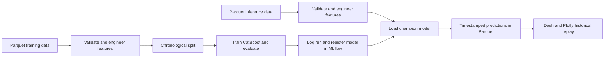

# Boston Bluebikes Demand Forecasting

[](https://github.com/wgeorgej/boston-bike-demand-forecasting/actions/workflows/ci.yml)
[](https://github.com/wgeorgej/boston-bike-demand-forecasting/actions/workflows/docker.yml)

**A reproducible machine learning workflow for forecasting aggregate Bluebikes ridership for the next hour.**

This project combines Kedro pipelines, CatBoost, MLflow, a Dash and Plotly dashboard, Docker Compose, and GitHub Actions. The dashboard replays saved historical forecasts against observed demand; it is not a live data feed.

## Business problem

Bike-sharing operators need to anticipate changes in rider demand when planning fleet availability, staffing, and other daily operations. This project investigates whether historical rider counts, calendar patterns, weather, and lagged demand can provide a useful short-term forecast of total hourly ridership.

The forecast is system-wide and aggregate. It does not estimate demand at individual stations or directly optimize bike redistribution.

## Problem statement

Given historical hourly demand and associated calendar, weather, and lagged-demand features, predict total Bluebikes riders for the next forecast hour. Evaluate predictions on a chronological holdout period to reflect the time-based nature of the problem.

## Objectives

- Build a repeatable data and modeling workflow with Kedro.
- Validate incoming data and apply the project's defined feature engineering.
- Train and evaluate a CatBoost regression model using a chronological split.
- Track model parameters, metrics, and artifacts in MLflow.
- Register model versions in MLflow and load the approved `champion` alias for inference.
- Save predictions with input and forecast timestamps.
- Display saved predictions and observed demand in a Dash and Plotly dashboard.
- Build and publish the Docker image through GitHub Actions.

## Success measures

### Historical model evaluation

The modelling notebook reports these metrics on its historical held-out test set:

| Metric | Result | Meaning |
| --- | ---: | --- |
| MAE | 45.63 riders | Average absolute prediction error per forecast row |
| RMSE | 78.21 riders | Error measure that penalizes larger misses more strongly |
| R² | 0.9669 | Coefficient of determination on the held-out test set |

These are historical evaluation results. They do not establish future performance or measured business impact.

### Business success measure

Compare hourly forecast MAE with a simple baseline, such as predicting that the next hour will have the same demand as the current hour. Calculate both on the same chronological holdout period before claiming an improvement. A relative MAE improvement can be calculated as `1 - (model MAE / baseline MAE)`.

Operational outcomes—such as fewer periods of low bike availability, fewer missed rentals, or reduced redistribution effort—would require operational data and evaluation after deployment.

## How it works



- **Kedro** organizes validation, feature engineering, training, and inference pipelines.
- **MLflow** stores experiment runs, model artifacts, and registered model versions.
- **Dash and Plotly** display historical actuals and predictions with year, month, and time-range controls.
- **Docker Compose** runs the dashboard and MLflow server, with training and inference available as on-demand jobs.
- **GitHub Actions** runs tests and builds and publishes the container image to GitHub Container Registry (GHCR).

## Data and forecasting assumptions

The project expects Parquet files at these catalog locations:

- Training: `data/03_primary/blue_bike_boston_model.parquet`
- Inference: `data/03_primary/blue_bike_boston_inference.parquet`
- Saved predictions: `data/07_model_output/predictions.parquet`

The data files are excluded from Git. Before reusing the project, obtain the source data and confirm its redistribution terms. **Dataset source and license:** [add the original source URL and license].

The existing feature and target transformations are row-based and intentionally preserved. Validation reports timestamp gaps longer than one hour but passes the rows through unchanged. At gap boundaries, “one row ahead” may not mean exactly one clock hour; account for this when interpreting the nominal one-hour forecast horizon.

## Repository structure

```text
conf/base/                  # Kedro catalog and parameters
entrypoints/                # Training, inference, and dashboard launchers
src/seoul_bike/pipelines/   # Kedro feature, training, and inference pipelines
src/app_ui/                 # Dash application, data helpers, and CSS
notebooks/                  # Exploration and modelling work
tests/                      # Data validation and project tests
docs/                       # Project and MLflow documentation
Dockerfile                  # Application container image
compose.yaml                # MLflow, dashboard, and on-demand job services
.github/workflows/          # Test and image build/publish workflows
```

## Run locally

### Requirements

- Python 3.12
- [`uv`](https://docs.astral.sh/uv/)
- Docker Desktop with its Linux container engine, for the Compose setup
- The required Parquet data files at the paths listed above

Install the locked development environment and run tests:

```powershell
uv sync --locked --extra dev
uv run --extra dev pytest -q
```

### Run services with Docker Compose

From the project root:

```powershell
docker compose up -d --build
```

Open:

- Dashboard: [http://localhost:8050](http://localhost:8050)
- MLflow UI: [http://localhost:5000](http://localhost:5000)

Check status and logs:

```powershell
docker compose ps
docker compose logs --tail 50 app-ui
docker compose logs --tail 50 mlflow
```

Run training or inference as an on-demand job:

```powershell
docker compose --profile jobs run --rm ml-train
docker compose --profile jobs run --rm ml-inference
```

Training creates a registered model version but does not automatically move the `champion` alias. Review its metrics in MLflow before promotion. To promote a reviewed version, replace `3` with its actual version number:

```powershell
uv run python -c "from mlflow import MlflowClient; c=MlflowClient(tracking_uri='http://localhost:5000'); name='Boston_Bike_Demand_Model'; version='3'; candidate=c.get_model_version(name, version); assert candidate.status == 'READY'; c.set_registered_model_alias(name, 'champion', version); print(f'champion now points to version {version}')"
```

The inference configuration in `conf/base/parameters.yml` should point at the alias:

```yaml
model_storage:
  uri: "models:/Boston_Bike_Demand_Model@champion"
```

Stop the services with `docker compose down`. This keeps the `mlflow-store` volume; avoid `docker compose down -v` unless you intend to delete the MLflow database and model artifacts.

## Published container image

The `main` branch workflow publishes the image to GHCR with `latest` and commit-specific tags:

```powershell
docker pull ghcr.io/wgeorgej/boston-bike-demand-forecasting:latest
```

The image is public. Running the dashboard also requires the expected data and configuration files to be available to the container, as they are in the Compose setup.

## Limitations and next steps

- The dashboard is a replay of saved historical inference results, not a live prediction service.
- The model forecasts aggregate ridership, not station-level demand.
- Timestamp gaps are warned about, not filled or resampled.
- The reported scores are based on a historical holdout and should be compared with a simple baseline.
- Automated production data ingestion, scheduled inference, drift monitoring, alerting, and a deployed public dashboard are not part of the current system.
- Operational business outcomes such as fewer missed rentals or lower redistribution effort have not been measured.

## Project documentation

See [`docs/mlflow_notebook_review.md`](docs/mlflow_notebook_review.md) for the review of the modelling notebook's MLflow logging, a recommended logging pattern, model verification, and promotion guidance.
